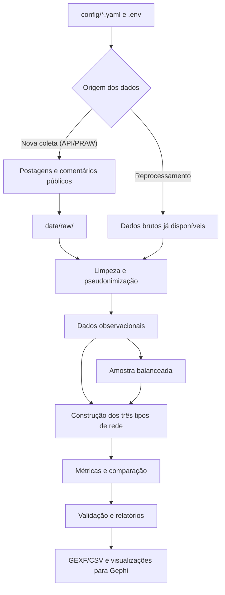

# Análise de redes de interação entre comunidades do Reddit

**Código e documentação de reprodutibilidade do Trabalho de Conclusão de Curso (TCC)** — Bacharelado em Sistemas de Informação, IFBA, Campus Feira de Santana (2026).

**Título da pesquisa:** *Análise da estrutura das redes sociais formadas pela influência de algoritmos de recomendação: um estudo das interações entre comunidades brasileiras e internacionais no Reddit.*

Este repositório reúne o pipeline em Python utilizado para **coletar publicações e comentários públicos do Reddit, transformar participações em grafos, calcular métricas estruturais e comparar comunidades brasileiras e internacionais**.

> **Escopo científico:** a pesquisa é observacional. As ordenações públicas do Reddit foram usadas para selecionar postagens, mas o código **não acessa os feeds personalizados dos usuários nem isola causalmente o efeito de algoritmos de recomendação**. As conclusões descrevem as estruturas de interação observadas na amostra.

## Conteúdo

1. [O que a pesquisa investiga](#o-que-a-pesquisa-investiga)
2. [Como funciona o pipeline](#como-funciona-o-pipeline)
3. [Metodologia implementada](#metodologia-implementada)
4. [Instalação e configuração](#instalação-e-configuração)
5. [Como executar e reproduzir](#como-executar-e-reproduzir)
6. [Onde encontrar os resultados](#onde-encontrar-os-resultados)
7. [Validação e testes](#validação-e-testes)
8. [Limites da reprodutibilidade](#limites-da-reprodutibilidade)
9. [Estrutura do repositório](#estrutura-do-repositório)

## O que a pesquisa investiga

O Reddit é organizado em comunidades temáticas, chamadas **subreddits**. Uma pessoa pode publicar, comentar e responder em uma ou várias dessas comunidades. O estudo transforma esses registros em redes para investigar:

- **Conectividade:** quem interage com quem e quão conectada é cada rede.
- **Coesão e agrupamentos:** componentes conectados, clusterização e comunidades estruturais.
- **Concentração:** distribuição das interações e centralidade de participantes.
- **Circulação entre comunidades:** participação compartilhada, usuários-ponte e sobreposição entre subreddits.
- **Robustez:** quais padrões persistem quando comentários de discussões muito grandes são balanceados.

Os oito subreddits configurados em [`config/collection.yaml`](config/collection.yaml) são:

| Bloco brasileiro | Bloco internacional |
| --- | --- |
| r/brasil | r/politics |
| r/brasilivre | r/worldnews |
| r/BrasildoB | r/geopolitics |
| r/NoticiasBR | r/news |

### Três representações complementares

| Rede | Nós | O que significa uma aresta? |
| --- | --- | --- |
| **Usuário–usuário** | Usuários | Um usuário respondeu ao comentário ou à postagem de outro. A versão dirigida preserva o sentido da resposta; o peso registra a frequência. |
| **Usuário–subreddit** | Usuários e subreddits (grafo bipartido) | Um usuário publicou ou comentou na comunidade; o peso indica a quantidade dessas participações. |
| **Subreddit–subreddit** | Subreddits | Duas comunidades compartilham pelo menos um participante; o peso corresponde ao número de usuários compartilhados. |

**Exemplo:** se A respondeu a B três vezes, a aresta A → B tem peso 3. Se A participou de r/brasil e r/worldnews, essas duas comunidades possuem ao menos um usuário compartilhado. **Participação compartilhada não comprova que uma informação foi transmitida de uma comunidade para outra.**

## Como funciona o pipeline



**Importante:** a geração dos subgrafos específicos de visualização é uma etapa adicional. As métricas são calculadas a partir de redes analíticas, **não** dos recortes de até 400 nós destinados a figuras.

O pipeline ainda utiliza a implementação consolidada em [`legacy_pipeline.py`](src/tcc_reddit/legacy_pipeline.py), orquestrada pela [interface CLI](src/tcc_reddit/cli.py). Os módulos em `collection/`, `processing/`, `networks/`, `metrics/`, `validation/` e `reporting/` organizam as responsabilidades da migração.

## Metodologia implementada

### 1. Coleta e seleção das postagens

A [configuração da execução histórica](config/collection.yaml) registra a janela em UTC **de 13/07/2025 06:20:34 a 13/07/2026 06:20:34**, com as ordenações públicas:

| Ordenação | Papel na seleção |
| --- | --- |
| `top` | Recuperar publicações destacadas segundo os critérios da listagem. |
| `controversial` | Recuperar itens classificados como controversos pela listagem disponível na API. |
| `hot` | Recuperar publicações em destaque por atividade/recência. |
| `new` | Recuperar publicações recentes. |

O código solicita **até 100 candidatas por ordenação e por subreddit** (não são 100 postagens finais). Em seguida:

1. filtra a janela temporal e exclui postagens fixadas (`stickied`);
2. elimina repetições pelo identificador da postagem (`submission_id`);
3. seleciona **até 150 postagens distintas por subreddit**, alternando as ordenações em *round-robin*;
4. recupera os comentários acessíveis das postagens escolhidas e registra a cobertura estimada.

Assim, **1.200 postagens** é o alvo de 8 × 150, condicionado à existência de candidatas elegíveis. As ordenações `hot` e `new` são listagens obtidas no momento da consulta, não um arquivo histórico integral. O limite de 100 aplica-se aos candidatos por ordenação; o de 150 aplica-se à seleção final por subreddit.

Os parâmetros são definidos em [`config/collection.yaml`](config/collection.yaml). A implementação da seleção encontra-se em [`networks/pipeline.py`](src/tcc_reddit/networks/pipeline.py).

### 2. Tratamento e pseudonimização

O processamento remove duplicações por identificador, mantém comentários associados a postagens selecionadas e cria hashes SHA-256 dos nomes de usuário com uma chave privada (`TCC_HASH_SALT`). Identificadores ausentes, excluídos e contas ignoradas pelo procedimento de limpeza não geram usuários artificiais. Os nomes originais são retirados das tabelas processadas.

### 3. Duas variantes de análise

| Variante | Procedimento | Finalidade |
| --- | --- | --- |
| **Observacional** (`observational`) | Preserva todos os comentários recuperados e válidos das postagens selecionadas. | Descrever a estrutura da atividade efetivamente coletada. |
| **Balanceada** (`balanced`) | Seleciona até 300 comentários inicialmente por postagem, estratificados pela profundidade das respostas: 40% nível 0, 40% níveis 1–2 e 20% nível 3 ou superior. Inclui ancestrais necessários para preservar relações de resposta. | Diminuir a influência de discussões excepcionalmente grandes nas comparações. |

Na variante balanceada, o total final de comentários de uma postagem **pode ultrapassar 300**, pois comentários ancestrais são acrescentados após o sorteio inicial. O sorteio utiliza semente configurável (padrão: 42). As duas variantes utilizam o mesmo procedimento de construção e análise de redes.

Veja [`config/sampling.yaml`](config/sampling.yaml) e [`networks/pipeline.py`](src/tcc_reddit/networks/pipeline.py).

### 4. Construção dos grafos e métricas

A rede usuário–usuário registra respostas ao autor de um comentário (`t1_`) ou de uma postagem (`t3_`), descartando autointerações e relações com autor inválido. São produzidas agregações dirigidas e não dirigidas com preservação do peso total.

As análises incluem, conforme o grafo: **densidade, grau médio e ponderado, componentes conectados, tamanho do maior componente, coeficiente de clusterização, assortatividade de grau, modularidade e comunidades pelo Louvain**, além de centralidade de grau, grau de entrada e saída, PageRank e intermediação aproximada. Para grafos com mais de 100 nós, a intermediação utiliza uma amostra de 100 nós por padrão. Os relatórios comparativos calculam também **Gini do grau ponderado, usuários-ponte e sobreposição de Jaccard** entre subreddits.

## Instalação e configuração

**Requisitos:** Git, Python **3.11 ou superior**, `pip` e espaço em disco/memória compatível com o volume da coleta. **Python 3.12** é uma referência adequada para a execução acadêmica. Uma nova coleta exige acesso autorizado à API do Reddit; reprocessamento local não exige conexão com o Reddit.

### Linux / macOS

```bash
git clone https://github.com/Nnando0220/code-tcc.git
cd code-tcc
python3 -m venv .venv
source .venv/bin/activate
python -m pip install --upgrade pip
python -m pip install -e .
python -m pip install pytest
cp .env.example .env
```

### Windows (PowerShell)

```powershell
git clone https://github.com/Nnando0220/code-tcc.git
cd code-tcc
py -3 -m venv .venv
.\.venv\Scripts\python.exe -m pip install --upgrade pip
.\.venv\Scripts\python.exe -m pip install -e .
.\.venv\Scripts\python.exe -m pip install pytest
Copy-Item .env.example .env
```

Nos comandos abaixo, `python` significa o interpretador do ambiente virtual. No PowerShell, sem ativação do ambiente, substitua `python` por `.\.venv\Scripts\python.exe`.

### Configurar o arquivo .env

Edite o `.env` criado a partir de [`.env.example`](.env.example):

```dotenv
REDDIT_CLIENT_ID=seu_client_id
REDDIT_CLIENT_SECRET=seu_client_secret
REDDIT_USER_AGENT=tcc-reddit/1.0 (contato/identificacao)
TCC_HASH_SALT=uma_chave_aleatoria_privada
```

Gere uma chave aleatória, por exemplo, com:

```bash
python -c "import secrets; print(secrets.token_hex(32))"
```

Copie o resultado para `TCC_HASH_SALT`. As credenciais `REDDIT_*` são necessárias **somente para nova coleta**. Para reprocessar os dados locais, apenas a chave privada é obrigatória; use a **mesma chave da execução original** se precisar reproduzir exatamente os identificadores pseudonimizados. Uma chave diferente altera os hashes dos usuários.

Para solicitar acesso à API e obter credenciais, consulte a [documentação para desenvolvedores do Reddit](https://www.reddit.com/dev/api/) e as políticas vigentes da plataforma.

## Como executar e reproduzir

Há **dois caminhos diferentes**, dependendo dos dados disponíveis.

### Caminho A — Reprocessar a coleta original (sem acessar o Reddit)

Recomendado para reproduzir as transformações e métricas da pesquisa **quando os dados brutos originais estão disponíveis**.

Os arquivos devem estar em:

```text
data/raw/run_2026_07_year_v2/
├── posts_raw.parquet
├── comments_raw.parquet
└── post_collections.parquet
```

O identificador da pasta deve corresponder ao `run_id` de `config/collection.yaml`. O código de leitura também aceita CSVs de mesmo nome-base, mas a publicação e a validação canônicas exigem os três arquivos Parquet.

Depois de configurar `TCC_HASH_SALT`, execute **na raiz do repositório**:

```bash
python scripts/reprocess.py
```

Esse comando reconstitui dados processados, ambas as variantes, redes, métricas, relatórios e validações a partir dos dados brutos locais. **Os três Parquet não acompanham este repositório:** é necessário obtê-los por um meio autorizado. Sem eles, o comando não pode reproduzir a coleta histórica.

### Caminho B — Fazer uma nova coleta (usa a API do Reddit)

1. Preencha as credenciais `REDDIT_*` no `.env`.
2. Edite [`config/collection.yaml`](config/collection.yaml): defina um **novo `run_id`** e uma janela temporal apropriada à data da nova coleta.
3. Revise os limites de coleta e os parâmetros de [`sampling.yaml`](config/sampling.yaml) e [`networks.yaml`](config/networks.yaml).
4. Execute:

```bash
python scripts/collect.py
```

A execução fará a coleta e depois percorrerá as mesmas etapas de processamento, análise e validação. **Não reutilize um `run_id` já registrado** para coletar dados novos: a aplicação bloqueia a sobrescrita de uma execução registrada.

> A janela 2025–2026 da configuração histórica já se encerrou. Executar a coleta novamente hoje **não restaura automaticamente** as listagens `hot`/`new` daquele período. Uma nova coleta constitui uma nova amostra, e o acesso aos dados está sujeito às condições e limites atuais da API.

### Comandos para etapas adicionais

Depois que os artefatos analíticos existirem:

| Comando | O que faz |
| --- | --- |
| `python scripts/analyze.py` | Recalcula os relatórios e as comparações com os dados já processados. |
| `python scripts/export_gephi.py` | Republica/exporta com nomes canônicos os GEXF e CSVs **já gerados**. Não substitui a construção das redes. |
| `python scripts/validate_all.py` | Executa a validação de dados, privacidade, pesos, grafos e estabilidade do Louvain. |
| `python scripts/build_visualization_graphs.py --all-variants` | Produz os subgrafos visuais, arquivos GEXF e prévias SVG das duas variantes. |
| `python -m pytest -q` | Executa a suíte de testes automatizados. |

A interface do pacote também aceita `tcc-reddit collect`, `tcc-reddit reprocess`, `tcc-reddit analyze`, `tcc-reddit publish` e `tcc-reddit validate` depois da instalação com `pip install -e .`. O arquivo `main.py` preserva a entrada de compatibilidade `python main.py --reprocess-existing`.

## Onde encontrar os resultados

Cada execução recebe um identificador próprio (`run_id`), usado como pasta de referência:

```text
data/
├── raw/<run_id>/                       # coleta original (restrita)
└── processed/<run_id>/
    ├── observational/                 # posts e comentários processados
    └── balanced/                      # amostra balanceada e manifesto

results/<run_id>/
├── manifest.json                       # versão, janela, contagens e semente
├── validation_report.json              # verificações da execução
├── observational/
│   ├── networks/                       # tabelas de arestas
│   ├── metrics/                        # medidas das redes
│   ├── gephi/                          # grafos completos/filtrados em GEXF
│   └── visualization/                  # figuras e subgrafos específicos
├── balanced/                           # mesma organização analítica
├── comparison/                         # sobreposição e comparação entre variantes
└── reports/                            # relatórios interpretativos
```

**Arquivos importantes para conferir a pesquisa:**

| Arquivo (sob a variante ou pasta indicada) | Conteúdo |
| --- | --- |
| `networks/user_user_edges_detailed.csv` | Respostas agregadas por usuários, subreddit, postagem e tipo de resposta. |
| `networks/user_user_edges_directed.csv` | Rede dirigida com pesos acumulados. |
| `networks/user_subreddit_edges.csv` | Participações de usuários em cada subreddit. |
| `networks/subreddit_subreddit_edges.csv` | Quantidade de usuários compartilhados por par de comunidades. |
| `metrics/metrics_by_subreddit.csv` | Indicadores estruturais por subreddit. |
| `metrics/centrality_users.csv` | Centralidades calculadas sobre a rede agregada. |
| `comparison/subreddit_overlap.csv` | Comparações de sobreposição e Jaccard. |
| `comparison/robustness_indicators.csv` | Comparação sintética das duas variantes. |

Para importar no **Gephi**, utilize os arquivos `.gexf`. Em `results/<run_id>/<variant>/visualization/`, a geração adicional disponibiliza, entre outros:

- `user_user_communities.gexf` — agrupamentos estruturais detectados;
- `subreddit_overlap_enriched.gexf` — conexões por participação compartilhada entre os oito subreddits;
- `cross_block_bridges.gexf` — participantes selecionados que conectam os dois blocos;
- `user_user_segmented.gexf` — distribuição de papéis estruturais, conexões e periferia.

As prévias, quando geradas, ficam em `visualization/previews/`. Os identificadores de exibição são abreviados (como `U0001`); a correspondência privada entre identificadores não deve ser divulgada.

## Validação e testes

Execute:

```bash
python -m pytest -q
python scripts/validate_all.py
```

São verificadas propriedades como unicidade das postagens, integridade das relações, janela temporal, remoção de identificadores diretos nos dados processados, preservação dos pesos ao agregar arestas, consistência entre CSV e GEXF, ancestrais da amostra balanceada e estabilidade da divisão de comunidades pelo Louvain.

Ao final de uma execução válida, verifique:

- `results/<run_id>/manifest.json` — registro da configuração resumida e do volume processado;
- `data/raw/<run_id>/manifest.json` — inventário com hashes SHA-256 dos arquivos brutos;
- `results/<run_id>/validation_report.json` — resultado da auditoria, incluindo `status: "valid"`;
- `results/<run_id>/comparison/` — medidas de sobreposição, comparação e robustez.

**Atenção:** a existência de um relatório válido comprova as verificações programadas, não a recuperação integral de todos os comentários existentes no Reddit nem a equivalência entre coletas de momentos diferentes.

## Limites da reprodutibilidade

Este repositório contém **código, parâmetros, documentação e testes**, mas não inclui os dados brutos e resultados completos, pois as pastas `data/` e `results/` são ignoradas pelo Git. Por isso, há três níveis distintos:

| Nível | O que é possível |
| --- | --- |
| **Inspecionar a metodologia** | Ler código, configurações e testes sem credenciais ou dados. |
| **Reproduzir o processamento** | Recalcular os artefatos a partir dos três Parquet originais, com o ambiente e a chave de pseudonimização adequados. |
| **Replicar a coleta** | Aplicar os mesmos critérios em uma nova consulta, gerando **outra amostra**, sujeita à disponibilidade e às regras atuais do Reddit. |

As dependências estão declaradas no `pyproject.toml`, mas suas versões não estão integralmente fixadas. Para maior comparabilidade, registre também a versão do Python, o hash do commit, as versões instaladas (`python -m pip freeze`), o `run_id`, os parâmetros YAML, a semente e os manifestos de cada execução. Resultados exatos podem variar por mudanças nas dependências ou nos dados disponíveis.

A análise mede **padrões estruturais de participação e resposta**, não exposição efetiva a conteúdos individuais, causalidade algorítmica, posição ideológica dos usuários ou fluxo de informação comprovado.

## Estrutura do repositório

```text
code-tcc/
├── config/                         # parâmetros da pesquisa e visualização
├── docs/
│   ├── ARCHITECTURE.md             # arquitetura e artefatos canônicos
│   └── REPRODUCIBILITY.md          # guia resumido
├── scripts/                        # entradas executáveis e utilitários
├── src/tcc_reddit/
│   ├── collection/                 # acesso à API e recuperação
│   ├── processing/                 # filtros, limpeza e amostragem
│   ├── networks/                   # construção e agregação de grafos
│   ├── metrics/                    # medidas e comparações
│   ├── reporting/                  # relatórios e manifestos
│   ├── validation/                 # auditoria dos dados e grafos
│   ├── visualization/              # seleção e exportação visual
│   ├── cli.py                      # interface de comandos
│   └── legacy_pipeline.py          # implementação consolidada da análise
├── tests/                          # testes automatizados
├── .env.example                    # modelo de variáveis privadas
├── pyproject.toml                  # definição do pacote e dependências
├── requirements.txt                # dependências alternativas de instalação
└── README.md
```

Para informações complementares, consulte [Arquitetura](docs/ARCHITECTURE.md) e [Reprodutibilidade](docs/REPRODUCIBILITY.md).
